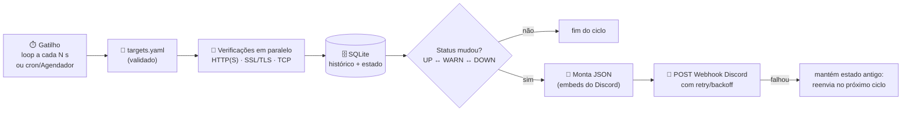
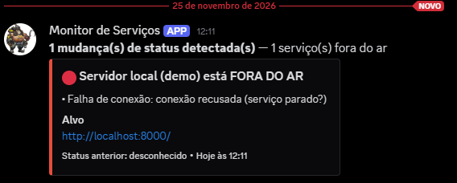

# 🛰️ Monitor de Serviços com Alertas no Discord

Automação em Python que verifica periodicamente a disponibilidade de sites, APIs e portas de rede, mede latência, confere a validade dos certificados SSL e **avisa no Discord somente quando algo muda**: caiu, ficou lento ou voltou ao ar.

> Trabalho final da disciplina **Automação e Programabilidade em Redes** (UniSenac Pelotas), Prof. Me. Wagner Loch.

---

## 1. Sobre o projeto e o problema resolvido

**A dor:** eu só descobria que um site ou serviço que uso estava fora do ar quando precisava dele, ou quando alguém reclamava. Certificados SSL vencidos também passavam despercebidos até o navegador bloquear o acesso. Conferir tudo isso à mão, abrindo site por site, é repetitivo e fácil de esquecer.

**A solução:** um monitor que roda sozinho em intervalos fixos e:

- detecta queda (timeout, conexão recusada, erro de DNS, HTTP 4xx/5xx, texto esperado ausente na página);
- detecta lentidão (latência acima do limite) e certificados SSL perto de vencer;
- testa portas TCP (DNS, SSH, banco de dados...);
- envia um alerta formatado no Discord **só na mudança de status**, sem repetir a cada minuto, e avisa quando o serviço volta, informando quanto tempo ficou fora;
- guarda o histórico em SQLite e gera um **relatório de uptime** das últimas 24h.

**Ganho prático:** fico sabendo de um problema em cerca de 1 minuto, pelo celular, sem precisar conferir nada manualmente, e tenho dados de disponibilidade em vez de impressões.

---

## 2. Arquitetura e fluxo de funcionamento



| Etapa | O que acontece | Arquivo |
|---|---|---|
| **Gatilho** | Loop interno a cada `CHECK_INTERVAL_SECONDS`, ou `--once` chamado pelo cron / Agendador de Tarefas | [main.py](main.py) |
| **Entrada** | Lê e valida o YAML (campos obrigatórios, URL, porta, auth) e aplica valores padrão | [monitor/config.py](monitor/config.py) |
| **Coleta** | Requisições HTTP(S) com `requests`, handshake TLS com `ssl`, conexão TCP com `socket`; todos os alvos em paralelo com `ThreadPoolExecutor` | [monitor/checks.py](monitor/checks.py) |
| **Persistência** | Grava cada verificação e o último estado de cada alvo no SQLite | [monitor/storage.py](monitor/storage.py) |
| **Decisão** | Compara o resultado com o estado anterior e só gera evento quando muda; `failures_before_alert` evita alarme falso | [monitor/alerts.py](monitor/alerts.py) |
| **Saída** | Transforma os eventos em JSON (embeds coloridos, lotes de até 10) e faz POST no webhook | [monitor/notifier.py](monitor/notifier.py) |

### Como os requisitos da disciplina são atendidos

| Requisito | Implementação |
|---|---|
| 1. Motor de automação | Python 3 com `requests`, `socket` e `ssl` |
| 2. Múltiplas integrações | HTTP(S) nos sites monitorados + API REST do GitHub + TLS + TCP + **Webhook do Discord** + banco **SQLite** |
| 3. Dados estruturados | Entrada em **YAML** validada; saída em **JSON** montada com lógica condicional (cor e título por status, agrupamento em lotes de 10); agregação SQL de uptime e latência média |
| 4. Credenciais seguras | Webhook e tokens só no `.env` (ignorado pelo git). O YAML guarda apenas o **nome** da variável (`token_env: GITHUB_TOKEN`). Suporte a **Bearer Token** e **Basic Auth**. A URL do webhook nunca é escrita no log |
| 5. Gatilho e saída | Agendamento temporal (loop ou cron) → alerta formatado no Discord + registro no banco |
| 6. Erros e resiliência | `try/except` para timeout, DNS, conexão recusada e SSL; validação de `status_code`; no Discord, retry com backoff em 5xx, respeito ao `retry_after` do 429 e erro explícito em 4xx; alerta não entregue é reenviado; o loop nunca morre por exceção |

---

## 3. Tecnologias e APIs utilizadas

- **Python 3.10+**
- **requests**: cliente HTTP para os sites monitorados e para o webhook
- **PyYAML**: leitura do arquivo de alvos (`yaml.safe_load`)
- **python-dotenv**: carrega variáveis do `.env`
- Biblioteca padrão: `socket` (TCP), `ssl` (certificados), `sqlite3` (banco), `concurrent.futures` (paralelismo), `logging`, `argparse`
- **Discord Webhooks API**: mensagens com *embeds* (JSON via HTTPS POST)
- **GitHub REST API**: exemplo de alvo autenticado com Bearer Token
- **pytest**: testes da lógica de alerta, configuração e payload

Protocolos: HTTP/HTTPS, TLS, TCP, DNS (resolução de nomes).

---

## 4. Pré-requisitos e como executar

**Pré-requisitos:** Python 3.10 ou superior e um servidor no Discord onde você tenha permissão para criar webhooks.

```bash
# 1. Clonar
git clone https://github.com/YannVoll/monitor-servicos-discord.git
cd monitor-servicos-discord

# 2. Ambiente virtual e dependências
python -m venv .venv
.venv\Scripts\activate          # Windows
# source .venv/bin/activate     # Linux/macOS
pip install -r requirements.txt

# 3. Configurar segredos
copy .env.example .env          # Windows  (Linux/macOS: cp .env.example .env)
```

Edite o `.env` e cole a URL do webhook (no Discord: *Editar canal → Integrações → Webhooks → Novo webhook → Copiar URL*). Depois edite o [targets.yaml](targets.yaml) com os sites e serviços que você quer monitorar.

```bash
# 4. Testar sem enviar nada (imprime o JSON que iria para o Discord)
python main.py --once --dry-run

# 5. Rodar
python main.py --once      # um ciclo
python main.py             # contínuo, a cada CHECK_INTERVAL_SECONDS
python main.py --report    # relatório de uptime das últimas 24h no Discord

# Testes
pip install -r requirements-dev.txt
python -m pytest -q
```

### Exemplo de alvo no `targets.yaml`

```yaml
- name: Minha API
  url: https://api.exemplo.com/health
  expected_status: [200, 204]
  keyword: "ok"              # opcional: texto que deve aparecer na resposta
  latency_warn_ms: 1500
  failures_before_alert: 2
  auth:
    type: bearer             # ou: basic (user_env + password_env)
    token_env: MINHA_API_TOKEN
- name: SSH do servidor
  type: tcp
  host: 192.168.0.10
  port: 22
```

### Deixar rodando em produção

- **Windows:** no Agendador de Tarefas, crie uma tarefa "Ao fazer logon" executando `.venv\Scripts\pythonw.exe main.py` com a pasta do projeto como "Iniciar em".
- **Linux:** use cron com `--once` (`* * * * * cd /opt/monitor && .venv/bin/python main.py --once`) ou um serviço systemd rodando `main.py` no modo contínuo.

---

## 5. Demonstração (resultados)

**Alerta de queda e de recuperação no Discord:**



**Relatório de uptime (`--report`):**


**Log de execução:**

```text
2026-11-25 11:59:37 INFO    Servidor local (demo)        UP       19ms
2026-11-25 11:59:43 INFO    Servidor local (demo)        DOWN        -  Falha de conexão: conexão recusada (serviço parado?)
2026-11-25 11:59:43 INFO    1 mudança(s) de status; notificando o Discord
2026-11-25 11:59:46 INFO    Servidor local (demo)        UP        8ms
2026-11-25 11:59:46 INFO    1 mudança(s) de status; notificando o Discord
```

**Reproduzir a demo:** em um terminal rode `python -m http.server 8000` (sobe o alvo "Servidor local (demo)"). Em outro, rode `python main.py`. Pare o servidor com `Ctrl+C`: o alerta 🔴 chega no Discord. Suba de novo: chega o 🟢 com a duração da queda.

---

## 6. Melhorias futuras (roadmap)

- [ ] **Relatório diário automático** agendado (ex.: 8h) e comando `/status` via bot do Discord
- [ ] **Container Docker** + `docker-compose` para rodar 24/7 em um homelab ou VPS
- [ ] **Painel web** (Grafana ou Flask) com gráficos de latência e uptime a partir do SQLite
- [ ] Verificações extras: ping ICMP, registros DNS e consulta SNMP de equipamentos de rede

---

## Estrutura

```text
├── main.py              # ponto de entrada: CLI, loop e ciclo de verificação
├── targets.yaml         # o que monitorar (sem segredos)
├── .env.example         # variáveis necessárias (copiar para .env)
├── monitor/
│   ├── config.py        # leitura e validação do YAML
│   ├── checks.py        # verificações HTTP(S), SSL e TCP
│   ├── alerts.py        # regra "alertar só quando o status muda"
│   ├── notifier.py      # JSON do Discord + envio com retry
│   └── storage.py       # SQLite: histórico, estado e uptime
└── tests/               # testes com pytest
```

Autor: **Yan Vollrath**: [github.com/YannVoll](https://github.com/YannVoll)
